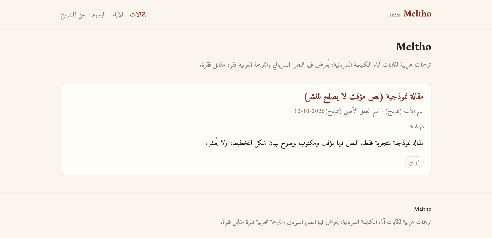
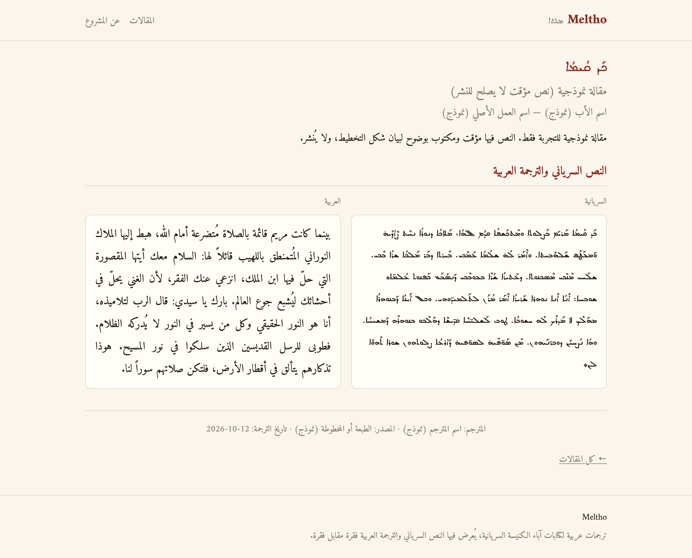
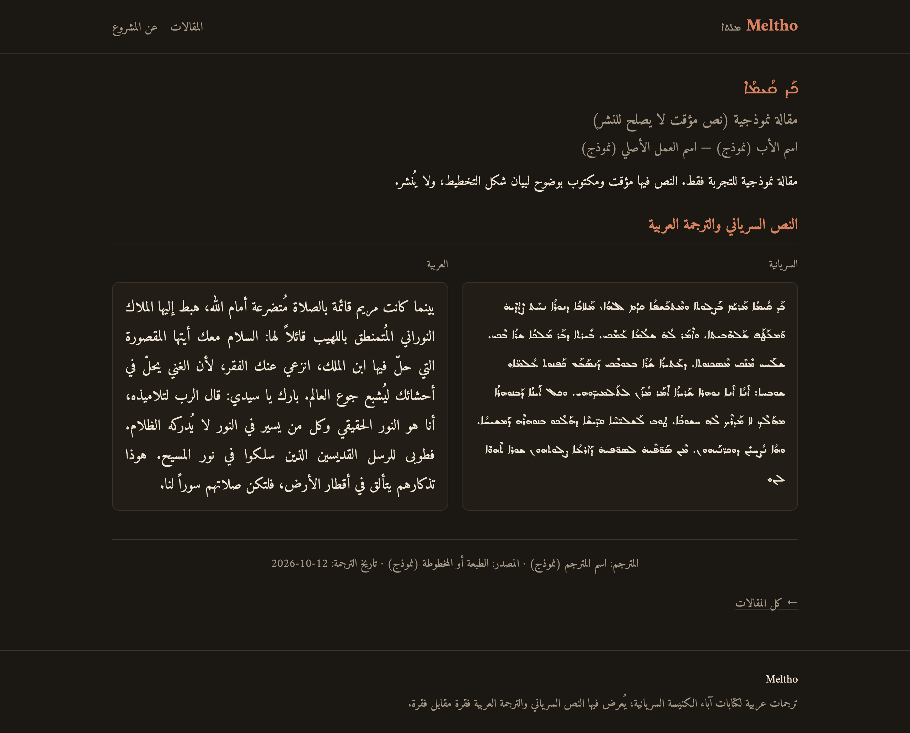

# Meltho

موقع ثابت لنشر ترجمات عربية لكتابات آباء الكنيسة السريانية، يُعرض فيه النص السرياني والترجمة العربية فقرة مقابل فقرة.

**الصفحة الرئيسية**



**صفحة المقالة — الوضع الفاتح**



**صفحة المقالة — الوضع الداكن**



- `npm install` — مرة واحدة.
- `npm run dev` — معاينة محلية (تظهر فيها المسودات أيضاً).
- `npm run build` — التحقق ثم بناء الموقع للنشر.
- `npm run preview` — معاينة الموقع المبني.
- `npm run syriac-fonts` — إعادة توليد خطوط السريانية (نادراً ما يُحتاج).

## إضافة مقالة جديدة

كل مقالة **ملف Markdown واحد** في `src/content/articles/`، ولا تحتاج تعديل أي كود. الفهرس و`sitemap` ووسوم المشاركة تُحدَّث تلقائياً.

1. **اسم الملف** لاتيني قصير بحروف صغيرة وشرطات، مثل `ephrem-faith-01.md`. اسم الملف يصبح الرابط: `/articles/ephrem-faith-01/`.
2. **املأ البيانات الوصفية** (القالب أدناه). الحقول المطلوبة: `title_ar` و`title_syr` و`author_slug` و`work` و`source` و`translator` و`translation_date` و`status` و`summary_ar`. العنوان السرياني (`title_syr`) يظهر عنواناً رئيسياً للصفحة بخط Serto Malankara. الأب يُكتب بمعرّف لاتيني (`author_slug`) من `src/config/fathers.ts`، والوسوم معرّفات لاتينية من `src/config/tags.ts`.
3. **اكتب المتن** أزواجاً: فقرة سريانية، سطر فارغ، الفقرة العربية؛ وبين كل زوجين سطر فيه `===` فقط.
4. **راجع:** `npm run dev`.
5. **انشر:** اجعل `status: published`. المسودات (`draft` أو `reviewed`) لا تظهر في الموقع المنشور.
6. **تحقق قبل النشر:** `npm run build`.

### قالب جاهز

```markdown
---
title_ar: عنوان المقالة
title_syr: ܥܢܘܢܐ
author_slug: ephrem
work: اسم العمل الأصلي
source: الطبعة أو المخطوطة أو الرابط
translator: اسم المترجم
translation_date: 2026-10-12
reviewer: اسم المراجع
status: draft
tags: [prayer]
summary_ar: ملخص قصير في سطر أو سطرين.
---

ܦܣܝܩܬܐ ܣܘܪܝܝܬܐ.

الفقرة العربية المقابلة.

===

**ܟܗܢܐ:** ܦܣܝܩܬܐ ܬܪܝܢܝܬܐ.

**الكاهن:** الفقرة العربية الثانية.
```

### إضافة أب أو وسم

الآباء في `src/config/fathers.ts`، والوسوم في `src/config/tags.ts`. لكل أب سطر:

```ts
ephrem: { name_ar: 'مار أفرام السرياني', dates_ar: '٣٠٦–٣٧٣م', bio_ar: 'ملاحظة قصيرة.' },
```

ولكل وسم سطر: `prayer: { label_ar: 'الصلاة' },`. استعمل المعرّف اللاتيني في المقالة (`author_slug: ephrem` و`tags: [prayer]`)، والاسم العربي يظهر في الموقع من السجلّ. معرّف غير معروف يوقف البناء برسالة تحدّد الملف والقيم المتاحة. ولكل أب أو وسم فيه مقالة منشورة صفحة خاصة (`/fathers/<slug>/` و`/tags/<slug>/`).

### تنبيهات

- كل كتلة **فقرتان بالضبط** (السرياني أولاً). إن اختلف العدد يفشل البناء برسالة تحدّد الملف ورقم الزوج.
- لا تُعدَّل النصوص ولا التشكيل ولا التنقيط. حذف التطويل (الكشيدة `U+0640`) يتم تلقائياً عند البناء.
- يُسمح بالتنسيق داخل الفقرة (`**عريض**` و`*مائل*`).
- لا تكتب أسماء الملفات بالعربية.
- صورة المشاركة حالياً موحّدة (`public/og-default.png`) لكل المقالات.
